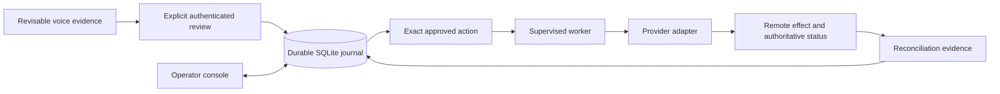

# ChronoCortex-Saga (CCS-Agent)

ChronoCortex-Saga is a research system for safe, recoverable, multi-step work
that can outlive the conversation that started it.

> **VOICE TURN ≠ TASK.** A voice turn is revisable evidence. A task is durable
> work with explicit authority, history, and a recoverable outcome.

The project studies how interruption, correction, worker failure, and uncertain
remote responses affect long-running tasks. Its web console is an operator
control and observability surface. The durable journal and server-side authority
checks remain the source of truth.

## Project status

This is an active research implementation, **not a production-readiness claim**.
The safety stack is developed in a series of unmerged pull requests; public
`main` remains the verified Phase 0 baseline at
`4162ec17f4bda15c13de3fa1f0e1e33e3fe35591`.

| Evidence label | Current meaning |
| --- | --- |
| **PUBLIC MAIN VERIFIED** | Public `main` is still the Phase 0 commit above; it does not contain the current safety stack. |
| **LOCAL BRANCH VERIFIED** | The active implementation is on `codex/ci-correctness-recovery` and tracked in draft PR [#45](https://github.com/dushyant-puro/chronocortex-saga/pull/45), stacked on earlier safety phases. Check the exact commit before relying on a result. |
| **SIMULATED** | Offline provider fixtures, synthetic voice evidence, and independent process-fault drills. These do not establish real provider or live audio behavior. |
| **REAL PROVIDER** | A real provider account, authorized operation, and authoritative status readback. This acceptance has not been run. |

At source commit `ba6197e11bfa9522c47dc840343a2f9f432eaf59`, the hosted push and
pull-request runs passed all ten Linux/Windows runtime, browser, and advisory
jobs combined (five jobs per run): [push run](https://github.com/dushyant-puro/chronocortex-saga/actions/runs/44519906710)
and [pull-request run](https://github.com/dushyant-puro/chronocortex-saga/actions/runs/44519899353).
The prior scan at `9222417` found the newly published OpenTelemetry advisory;
the current lock update pins its patched release. Earlier CI failures and
corrections remain in the [CI contention investigation](docs/engineering/ci-local-contention.md)
and [advisory record](docs/engineering/dependency-advisories.md). Results apply
to the exact recorded source, not automatically to later commits.

## What is implemented

- A durable SQLite journal for tasks, actions, claims, approvals, events, and
  provider-operation evidence, with workflow version checks and worker lease
  fencing.
- Conservative handling of stale and uncertain outcomes. Coroutine cancellation
  is not treated as remote rollback, and unknown mutations are not blindly
  retried.
- An authenticated local operator console for evidence review and scoped
  decisions. The browser does not own task state or bypass server authority.
- Reviewed proposal-to-task admission, durable review evidence, and a manual
  local walkthrough with separate approvals for each simulated task step.
- A restricted Stripe test-mode adapter and supervised one-resource drill,
  plus GET-only preflight and reconciliation commands. Automated provider
  fixtures are **SIMULATED**; no **REAL PROVIDER** acceptance is claimed.
- Revision-aware, proposal-only voice evidence and a deterministic synthetic
  replay scorecard. There is no live microphone/STT acceptance, and speech does
  not authorize mutations or complete tasks.
- Locked Python dependency graphs, dependency advisory checks, journal
  preflight, encrypted backup and restore drills, key rotation, and offline
  wheel verification.
- Deterministic mutation, durable-task, voice, and independent process-fault
  evaluations. Existing research corpora are small and synthetic; they do not
  establish universal novelty or production performance.

The full milestone history, architecture, exact-source qualifications, safety
invariants, and limitations are in [implementation.md](implementation.md).
The seven open release-acceptance areas are tracked in the
[production-readiness ledger](docs/engineering/production-readiness.md).

## Architecture at a glance



The implementation is modular and local-first: one journal, explicit worker
ownership, and narrow provider boundaries. Local fencing protects local state;
it cannot undo or fence a request already accepted by an external provider.
The configured recovery host can inspect an existing stopped journal, but it
has no executor and does not automatically replay work.

## Try the local walkthrough on Windows

This path runs the styled console and a two-approval task against a **SIMULATED
local effect ledger**. It needs no provider key or microphone.

From PowerShell in the repository root:

```powershell
.\scripts\start_review_walkthrough.ps1
```

Open the loopback HTTP address printed by the script and follow the
[manual review walkthrough](docs/engineering/manual-review-walkthrough.md).
Opening `control/static/index.html` directly displays startup instructions;
the live console must be served by the local host. The older
[pre-admitted walkthrough](docs/engineering/local-acceptance.md) is also
available. Neither walkthrough sends a real provider mutation.

To inspect an existing stopped journal, use the
[configured recovery host](docs/engineering/configured-recovery-host.md).
It reports authenticated readiness and recovery observations without dispatch
or automatic replay.

## Reproduce checks

The runtime suite needs no live credentials. Use Python 3.13 and the hash-locked
setup and platform guidance in
[locked environments](docs/engineering/locked-environments.md). From the
repository root in PowerShell, a fresh runtime environment can be prepared and
checked with:

```powershell
py -3.13 -m venv .venv
New-Item -ItemType Directory -Path results -Force | Out-Null
.\.venv\Scripts\python.exe -m pip --isolated install --require-hashes --only-binary=:all: --report results/install-runtime.json -r requirements.txt
.\.venv\Scripts\python.exe -m pip check
.\.venv\Scripts\python.exe -m scripts.dependency_audit --profile runtime --output results/environment-runtime.json
.\.venv\Scripts\python.exe -m pytest -q -p no:cacheprovider
.\.venv\Scripts\python.exe -m eval.provider_faults --output results/provider-process-scorecard.json
```

For the browser suite, install the separately locked browser profile and follow
the same runbook. CI runs runtime and browser matrices on Windows and Linux,
plus dependency advisory checks. Qualification numbers, skips, source commits,
and failed predecessors are recorded per phase in
[implementation.md](implementation.md); test counts from one commit must not
be carried forward to another.

## Safety boundaries

- Speech and conversational correction can revise a proposal; they cannot
  silently cancel, replace, authorize, or complete durable work.
- Dispatch requires exact durable intent and current approval. A local epoch,
  lease, UI response, or cancelled coroutine is not evidence that a remote
  effect was undone.
- An uncertain remote outcome stays uncertain until authoritative provider
  evidence resolves it. Never blindly retry an unknown mutation.
- Backups, restores, and recovery checks do not renew old authority or prove
  remote state. Preserve journal and provider evidence during rollback.

## What remains

The production-readiness ledger identifies seven acceptance areas still open:
real provider behavior, live voice and identity, durable proposal delivery and
end-to-end review, managed deployment and operations, disaster-recovery custody,
broader independent evaluation, and consolidated release qualification. Real
sandbox credentials, live audio, native service installation, operational SLOs,
and independent held-out evaluation must be qualified separately. Passing
offline tests does not close those gates.

Useful starting documents:

- [Implementation and qualification record](implementation.md)
- [Production-readiness ledger](docs/engineering/production-readiness.md)
- [Operator console and credential setup](docs/engineering/operator-control-console.md)
- [Windows Stripe sandbox setup](docs/engineering/stripe-sandbox-setup.md)
- [Voice evidence boundary](docs/engineering/voice-evidence.md)
- [Migration and rollback](docs/engineering/zero-activity-task-replacement.md)
