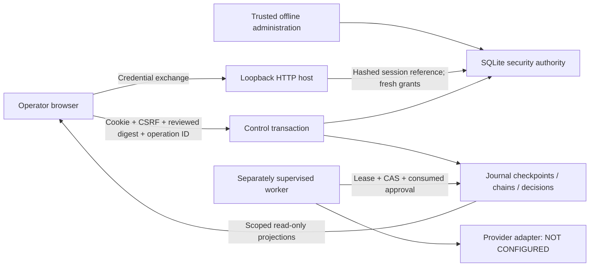

# Safety phase 1j: authenticated operator console

Stacked on `production/durable-security-authority` at
`00e62370ef46afeaa74019e043d033b62eb06e91`. **PUBLIC MAIN VERIFIED** remains
`4162ec17f4bda15c13de3fa1f0e1e33e3fe35591`; this safety stack is unmerged.
The API, browser sessions, control transactions and SQLite evidence use the
actual implementation. All effect fixtures and screenshots are **SIMULATED**.
No **REAL PROVIDER** or reconciliation worker is configured. A current lease is
authority within its time window, not proof that a worker is alive.

## Scope and data flow

One modular loopback host serves first-party HTML/CSS/JavaScript and scoped HTTP
endpoints. It uses the existing journal and security authority; there is no
second task database, browser state machine, provider executor, or new service.



The console shows recent tasks, action/compensation state, exact payloads,
receipts, epochs/generations, operation keys, workflow/provider contracts,
approval status and the current operator's decision history. Reads select at
most the latest 200 physical rows per category **before** permission filtering;
the result is a recent window, not a complete count or pagination system. Exact
ID inspection supports older records. Task detail limits owned effects to 200,
labels its total and unresolved window count, and includes all owned versions
in the review digest. An operator needs the workflow's domain permissions and
every owned action's recorded permissions to inspect or cancel a task. These
are permission domains, not tenant isolation or field-level redaction.

## Decision invariants and acceptance evidence

| Invariant | Implementation / regression evidence |
| --- | --- |
| The UI never becomes authority | No optimistic lifecycle updates, sample-data injection, execution button or mutation retry. Read failures retain labeled stale evidence and disable decisions. Backend eligibility and authorization are independent of button state. |
| Browser possession alone cannot grant new privileges | Offline credentials need ccs:observe; opaque HttpOnly, SameSite=Strict sessions reference an existing credential, current principal version and bounded expiry. Every read/decision rechecks authority. Revocation, principal changes, expiry and logout survive restart. |
| A decision applies to the evidence reviewed | Exact record/chain/checkpoint review digests are checked inside BEGIN IMMEDIATE with the control decision. Concurrent checkpoint/effect changes return 409. Same-principal UUID4 operation IDs replay only the identical recorded request; a changed request conflicts. |
| Local control records commit atomically | Approval/revocation or cancellation, its command result and control event commit together. SQL trigger fault tests roll back the entire decision. Separate connections serialize duplicate and competing cancellation requests. |
| Cancellation preserves remote uncertainty | The transaction closes the task chain and writes a CANCELLED checkpoint. It changes no action outcome, stops no in-flight request and performs no compensation. Old checkpoint writers fail CAS. |
| A returned effect cannot become current after durable cancellation | A deterministic barrier test reproduced a worker missing another connection's chain closure. The journal now classifies returned or reconciled forward evidence against durable chain/checkpoint eligibility inside finalization. The receipt commits as COMMITTED_STALE, never enters the current chain and never triggers automatic undo from that classification. |
| Unknown mutations are never retried by a browser failure | Reconciliation records REQUESTED / NOT_CONNECTED only. It preserves action evidence and deduplicates further requests for that action. A Chromium test loses the response after the server records the request and verifies exactly one POST and the retained decision history. |
| Secrets stay out of normal persistence and output | Only credential/session verifiers and a CSRF derivation salt persist. Bearer, session and CSRF values do not occur in a SQLite dump. No local/session storage, credential JSON response, access log, URL token or console printing. Offline issuance delivers exclusively to a protected file. |
| Untrusted evidence remains text | First-party DOM creation uses textContent, not innerHTML. XSS evidence, read-only users, keyboard dialog focus/Escape, desktop and 390px layouts are tested in real Chromium. Visual captures are inspected separately. No full accessibility certification is claimed. |

Finalization retains worker lease and action-version fencing. A lost lease, CAS
conflict, database failure or process death can still leave durable UNKNOWN
intent even when an in-memory receipt exists; the selected provider must resolve
that uncertainty. Receipt preservation is not a remote fence, transactional
rollback, compensation or proof that the effect is desired. Historical COMMITTED
effects remain applied when a task is cancelled and require separate review.

The browser polls reads every five seconds, backs off to thirty seconds after
failures, times out fetches after ten seconds, and pauses hidden tabs. It clears
rendered private evidence on disconnect. POSTs are never retried automatically.
A missing response means the decision may already be recorded: read decision
history before issuing another operation. A stale-review response closes review
and requires fresh evidence. The server remains decisive between polls.

## HTTP and trust boundary

The CLI binds only `127.0.0.1`, rejects forwarded proxy headers, and enforces an
exact configured loopback Host/scheme. API writes require exact Origin and CSRF;
cross-origin API reads are rejected. There is no CORS or network provisioning
endpoint. Security headers include no-store, strict CSP, no framing, no-sniff,
no referrer, and disabled camera/microphone/geolocation. JSON has duplicate-key,
nonfinite-number, content-type, 16 KiB and five-second body bounds. The server
limits concurrent connections; a process-local login budget admits five attempts
per minute. It is not a distributed rate limiter. Generic errors contain a
request ID and no exception payload; normal access logging is disabled.

Sessions expire within fifteen minutes or credential expiry, whichever comes
first. At most eight sessions per credential remain active; reconnect rotates
the presented session. HTTPS enables Secure cookies. Plain HTTP here is a
same-machine development/operations transport, not a trusted production network
login. This host authenticates a provisioned credential, not verified human
identity, SSO, MFA, or a tenant. Local OS accounts, filesystem ACLs, trusted clocks
and SQLite disk/locking/flush semantics remain part of the trust boundary.

| Permission | Control meaning |
| --- | --- |
| ccs:observe plus recorded domain grants | Read permitted journal records |
| ccs:approve plus operation grants | Issue/revoke a scoped, named, expiring approval |
| ccs:repair additionally | Approve compensation, as a separate direction/receipt binding |
| ccs:cancel plus all task/effect grants | Record local cancellation and close its chain |
| ccs:reconcile plus action grants | Record an investigation request; no connected executor |
| ccs:legacy-control additionally | Inspect/cancel legacy records without verifiable policy; legacy mutation approval remains denied |

Approval status also checks current issuer/executor permissions, security
versions, issuer credential and exact operation binding. Forward approvals on a
closed/inactive task are invalidated in the projection. Dispatch still repeats
its own checks and consumes approval atomically with intent. Approval does not
start a worker; revocation does not retract an intent already committed.

## Windows setup: new local installation

Use Python 3.13. The generated requirements now include transitive pins/hashes;
follow the [locked environment gate](locked-environments.md) for fresh installs,
an exact runtime/browser metadata audit and retained installation evidence.
From this branch's repository root:

```powershell
py -3.13 -m venv .venv
.\.venv\Scripts\python.exe -m pip install -r requirements.txt
.\.venv\Scripts\python.exe -m pip check
.\.venv\Scripts\python.exe -m pytest -q -p no:cacheprovider
```

Keep journal and secrets outside the checkout, on a local disk. For a **new**
directory, this creates a protected ACL for the current user and SYSTEM before
creating the database or credential. Inspect the resulting ACL; apply your
organization's host access policy for an existing deployment instead of resetting
its ACL. Do not use a shared/synced directory.

```powershell
$ccsRoot = Join-Path $env:LOCALAPPDATA 'ChronoCortexSaga'
if (Test-Path -LiteralPath $ccsRoot) { throw 'Directory exists: review its ACL and deployment state first.' }
New-Item -ItemType Directory -Path $ccsRoot | Out-Null
$ccsOwner = [System.Security.Principal.WindowsIdentity]::GetCurrent().User
$ccsSystem = [System.Security.Principal.SecurityIdentifier]::new('S-1-5-18')
$ccsAcl = [System.Security.AccessControl.DirectorySecurity]::new()
$ccsAcl.SetOwner($ccsOwner)
$ccsAcl.SetAccessRuleProtection($true, $false)
foreach ($ccsIdentity in @($ccsOwner, $ccsSystem)) {
    $ccsRule = [System.Security.AccessControl.FileSystemAccessRule]::new($ccsIdentity, 'FullControl', 'ContainerInherit,ObjectInherit', 'None', 'Allow')
    $ccsAcl.AddAccessRule($ccsRule)
}
Set-Acl -LiteralPath $ccsRoot -AclObject $ccsAcl
Get-Acl -LiteralPath $ccsRoot | Format-List Owner,AccessToString
$env:CCS_JOURNAL = Join-Path $ccsRoot 'ccs.db'
.\.venv\Scripts\python.exe -c "import os; from runtime.action_journal import SQLiteActionJournal; SQLiteActionJournal(os.environ['CCS_JOURNAL'])"
```

Create a new console principal offline. The following permissions are an
administrative example; replace fleet:write with the actual workflow domain and
omit controls the operator should not have. Grants never come from a transcript.
The issuer refuses existing principals/files and prints only public metadata.
On Windows the secret file inherits the directory ACL; the utility does not
certify that ACL. POSIX creation uses exclusive 0600 files in a protected directory.

```powershell
$ccsSecret = Join-Path $ccsRoot 'operator.secret'
.\.venv\Scripts\python.exe -m control.provision --journal $env:CCS_JOURNAL --principal local-operator --permission fleet:write --permission ccs:approve --permission ccs:cancel --permission ccs:reconcile --permission ccs:repair --credential-file $ccsSecret
Set-Clipboard -Value (Get-Content -Raw -LiteralPath $ccsSecret)
.\.venv\Scripts\python.exe -m control --journal $env:CCS_JOURNAL
```

Open [the local console](http://127.0.0.1:8877), paste the credential, and connect.
Clear the clipboard after pasting (`Set-Clipboard -Value ''` in another shell).
The credential expires within 24 hours. Rotate/revoke with the trusted offline
security API; no perpetual login, browser token renewal or hidden bootstrap
principal exists. If offline delivery crashes, inspect/revoke its credential ID
before issuing another. The initial journal is empty; no demo data or worker is
started. Real workflow hosting and a supervised lease are separate release gates.

For local TLS, use `--tls-cert <certificate.pem> --tls-key <private-key.pem>` and
the resulting exact HTTPS origin. Keep private keys protected. This CLI does not
support a reverse proxy or remote bind; adding either needs a separate transport,
identity, origin/cookie and threat-model review.

## Migration, deployment and rollback

Schema 6 adds operator_sessions, control_commands and control_events. Schema-5
action, credential, approval and checkpoint data is preserved. Initialization and
migration are never implicit in server startup or provisioning. For an existing
journal, stop and await workers, preserve unresolved provider identities, and
release/expire its lease. Make a consistent offline backup including any required
SQLite sidecars; never copy a live database piecemeal. Explicitly migrate with:

```powershell
.\.venv\Scripts\python.exe -c "import os; from runtime.action_journal import SQLiteActionJournal; SQLiteActionJournal(os.environ['CCS_JOURNAL'], migrate=True)"
```

Migration refuses a current lease. Old schema-5 readers/writers reject schema 6;
the runtime return type of transition remains compatible while forward result
finalization has a dedicated atomic classification path. Crash/failure fixtures
intercept their shared transaction boundary so both intent and result persistence
fault windows remain exercised.

On a regression, stop HTTP decisions and worker dispatch, preserve the schema-6
journal and all current action/control/security evidence, then diagnose using a
compatible reader. Revert application changes only with schema-6 compatibility.
An old backup is usable only when no later intent/receipt/decision would be lost.
Never drop control/security tables, delete operation claims, reactivate revoked
credentials, unconsume approvals, reopen a cancelled chain, or revert to volatile
execution as rollback machinery. No code/database rollback reverses a provider
effect. Reconcile against the provider before any new mutation.

## Reproducible validation and remaining gates

```powershell
.\.venv\Scripts\python.exe -m pip install -r requirements-browser.txt
.\.venv\Scripts\python.exe -m playwright install chromium
.\.venv\Scripts\python.exe -m pytest browser/console_cases.py -q -p no:cacheprovider
.\.venv\Scripts\python.exe eval/adversarial_scorecard.py
```

Local Windows: **519 passed, 1 skipped** in the full runtime suite, plus **7
passed** in real Chromium. The phase adds 52 control API cases and 3 offline
provisioning cases, including deterministic cancellation during forward/status
awaits. The draft PR records exact-commit fresh-clone/new-environment validation
and Windows/Linux runtime/browser CI. Browser captures in results/console-visual
contain only SIMULATED fixture data and are ignored by Git. Top-level browser
dependencies are pinned and Chromium is installed by the pinned Playwright
release; transitive locking and OS/browser image pinning remain outstanding.

The legacy **SIMULATED** scorecard remains 15/20 completed trials; five restart
trials park. That is an explicit incomplete result, not a production recovery
rate. The live voice test is still a skipped placeholder. No live-provider,
production deployment, accessibility certification, performance or availability
result is claimed. Reconciliation request recording is not implemented remote
reconciliation, and there is no consumer connected to that request ledger yet.

Next gate: a tested worker lease supervisor, shutdown/drain/recovery protocol,
health signals distinct from lease validity, and managed credential injection.
Then select a real provider using documented sandbox/idempotency/status-query and
delayed-application guarantees before implementing its reconciler/repair adapter.
Real voice event ordering/confidence/revisions, external identity, TLS deployment,
audit retention/monitoring, capacity tests, tenant boundaries and independent
evaluation remain release gates. A polished console does not close those gaps.

The implementation follows the primary documentation for
[Starlette middleware](https://starlette.dev/middleware/),
[Playwright browser testing](https://playwright.dev/python/docs/intro),
[SQLite isolation](https://sqlite.org/isolation.html), and
[OWASP CSRF defenses](https://cheatsheetseries.owasp.org/cheatsheets/Cross-Site_Request_Forgery_Prevention_Cheat_Sheet.html).
These explain design choices, not certification of this implementation.
