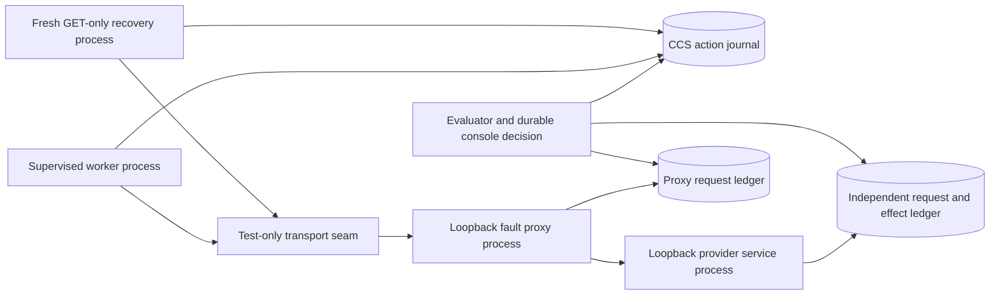

# Independent process and network fault acceptance

Status: **LOCAL BRANCH VERIFIED**, with **SIMULATED** provider effects. This
harness uses actual OS processes, SQLite files and loopback TCP connections.
It makes no REAL PROVIDER calls and needs no Stripe account, API key, microphone
or browser. The real-provider acceptance gates remain open. Public main is still
the unmerged Phase 0 baseline; use a reviewed safety branch for these commands.

## Scope and data flow

`eval.provider_faults` supervises a service process, a fault-proxy process, and
separate execution/recovery worker processes. These are disposable test peers,
not production services or deployment requirements.



The production adapter constructs its original fixed HTTPS Stripe request. The
explicit Python test seam accepts only that original origin, allowlisted routes
and the built-in dummy key, then forwards it over real HTTP to `127.0.0.1`.
The proxy can forward only to another numeric loopback port. Neither the
evaluator nor the production CLIs acquire a configurable remote origin. The fake
factory rejects any account or restricted test key other than the bundled fake
identities. Environment proxies, redirects and TCP retries are disabled.

The service commits its own SQLite request/effect transaction before replying.
For an applied mutation, the proxy receives that reply and emits a flushed
`RESPONSE_WITHHELD_AFTER_APPLY` barrier before sending any response bytes to the
worker. The evaluator can then kill the worker at that exact boundary. Separate
proxy and service request ledgers distinguish an attempted request from one
received by the service. They are not derived from CCS action state.

Durable console approval is recorded through `ControlStore` with a separate
operator principal. This evaluator automates the decision for its disposable
fixture only. It does not add automatic approval to the production host. UI
approval is separately covered by the Chromium suite.

## Cases and acceptance invariants

| Case | Independently observed effect | Required result |
| --- | --- | --- |
| Response lost after application | One cancel POST and one service effect | Current worker obtains positive GET evidence and readback; fresh-owner investigation remains COMMITTED_STALE. No second POST. |
| Worker killed after application | One effect, with no local receipt at the kill barrier | No graceful lease-release event. Premature takeover performs no HTTP. After controlled expiry, a fresh process uses GET only and records COMMITTED_STALE. |
| Worker killed before approval/dispatch | No POST and no effect | Raw PENDING history can remain; recovered projection is IN_FLIGHT_UNKNOWN. No approval consumption or executor replay. Claim remains held. |
| Request discarded before forwarding | Proxy sees one POST; service sees zero | Local dispatch intent cannot prove a remote effect or its absence. Open GET leaves IN_FLIGHT_UNKNOWN; no retry. |
| Applied effect hidden from status reads | Service ledger already contains one effect | Open GET never becomes proof of nonexecution. Current and fresh workers retain UNKNOWN until visibility is explicitly released; another GET resolves stale evidence without a second POST. |

Every case compares wire operation keys and independent effect identities to
the journal, checks approval consumption and retained claims, requires a clean
recovery-owner release, verifies that all recovery requests are GETs, and checks
for private provider fields and bearer tokens in output and journal evidence.
Adversarial oracle tests inject duplicate requests/effects, wrong operation keys,
wrong receipt scope, open-state receipts, fabricated success on UNKNOWN and
inverse requests. They must fail the appropriate checks.

Recovered PENDING is a projection distinction: a GET with no new positive proof
does not rewrite the original record merely to rename it. The scorecard reports
both `durable_state` and `first_recovery_projection`. Neither permits replay.

The fixture clock advances only after the killed worker and the denied
replacement have exited. This exercises real lease acquisition and journal
fencing without a wall-clock sleep. It does not simulate clock failure, physical
power loss or a production lease policy change. Process kills inject failures;
they do not undo a service effect.

## Windows reproduction

From a clean checkout of the reviewed branch, with Python 3.13 installed:

```powershell
py -3.13 -m venv .venv
.\.venv\Scripts\python.exe -m pip install -r requirements.txt
.\.venv\Scripts\python.exe -m pip check
.\.venv\Scripts\python.exe -m pytest tests/test_provider_process_faults.py -q -p no:cacheprovider
.\.venv\Scripts\python.exe -m eval.provider_faults --output results/provider-process-scorecard.json
$LASTEXITCODE
Get-Content results/provider-process-scorecard.json
git rev-parse HEAD
git status --short
```

Run the full runtime suite with `python -m pytest -q -p no:cacheprovider`.
CI runs that suite and the standalone evaluator on Windows and Linux, retaining
the JSON scorecard as `simulated-provider-process-<OS>` for seven days. Ordinary
loopback sockets and child processes must be available; a sandbox that prevents
them has not passed this gate. Missing barriers, unexpected process exits and
unavailable sockets count as failures, never skipped successful checks.

CLI exit 0 requires every case and check to pass. Exit 1 means at least one
failed or incomplete drill. Exit 2 means invalid arguments or inability to
preserve the scorecard. Inspect `cases_failed` as well as `checks_failed`.
The report is written through a flushed temporary file and atomic replacement.
It contains raw fake request/effect ledger rows, action event kinds, counts,
the Python/SQLite/platform versions, source commit and source dirtiness.
Unavailable Git provenance stays null, never clean. `harness_sha256` hashes the
two harness files with normalized line endings; it does not identify every
runtime dependency or replace the source commit and pinned requirements.

Temporary credentials, journals and sockets are torn down after each run. The
scorecard retains redacted synthetic evidence for independent inspection. No
real key file or existing production journal is a supported evaluator input.

## Remaining gates and rollback

This fake service has no Stripe idempotency fidelity, TLS, request-log retention
contract, rate limits, settlement behavior or independently administered remote
infrastructure. Its ledger proves only what this SIMULATED service did. There
are no latency or throughput claims. Host power loss, disk corruption, network
partitions spanning production hosts, real sandbox permissions/revocation and
real audio acceptance still require separate work.

The next provider gate is the protected, GET-only real sandbox preflight and a
reviewed procedure for obtaining one known disposable test object, followed by
the explicitly approved supervised cancellation. A live response-loss drill
requires a separately reviewed interception setup; this loopback evaluator
does not weaken the production adapter to enable it. See
[provider acceptance](provider-reconciliation.md#remaining-acceptance-gates).

Rollback removes the evaluator/CI step and returns to the preceding verified
safety branch. No production schema, operation identity, mutation dispatch,
approval rule, transport default or repair policy changes in this phase.
Retain any real journal/claims/receipts unchanged. Never restore an old journal
or replay an uncertain mutation to compensate for removing a test harness.
