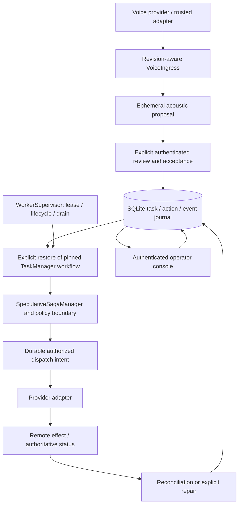

# ChronoCortex-Saga implementation record

Review date: **2026-11-02** (client date). Repository:
[dushyant-puro/chronocortex-saga](https://github.com/dushyant-puro/chronocortex-saga).

This is an implementation and acceptance ledger, not a production-readiness
certificate. The thesis remains **VOICE TURN ≠ TASK**: conversational evidence
can change while task identity, operation claims and possible remote effects
remain durable and accountable. A UI, coroutine cancellation or local state
transition cannot establish that a remote effect was undone.

## Source and evidence status

| Label | Meaning in this report |
| --- | --- |
| **PUBLIC MAIN VERIFIED** | Public `main` was verified at `4162ec17f4bda15c13de3fa1f0e1e33e3fe35591`, the Phase 0 baseline. It does not contain the safety stack. |
| **LOCAL BRANCH VERIFIED** | The implementation was inspected/tested at the stated branch or commit. Published feature branches contain the stack, but they are unmerged. Tests apply to their exact source. |
| **REPORTED BUT UNVERIFIED** | A historical claim without inspected code or retained evidence. It cannot close an acceptance gate. |
| **SIMULATED** | Synthetic voice or fake provider effects, including real subprocess/TCP/SQLite drills. Real transport/processes do not make the provider real. |
| **REAL PROVIDER** | Actual provider account, permissions, operation and authoritative reconciliation. This acceptance has **not run**. |

The preceding feature is [draft PR #29](https://github.com/dushyant-puro/chronocortex-saga/pull/29),
branch `codex/reviewed-task-admission`, head
`0b29abf8ae39cda0df8e9ce6ff9289c59d3a59bb`. Its base is the Windows setup
diagnostics branch at `37e1d86`. The subsequent bounded qualification phase starts
from this head on `codex/qualification-failure-evidence`, [draft PR #30](https://github.com/dushyant-puro/chronocortex-saga/pull/30).
Its observer/regression implementation is `452b8b9f556cc5eee2d93a93214d493ff9ee7367`;
the report follow-up `973f532` passed all ten push/PR CI jobs. The current
hands-on feature is [draft PR #31](https://github.com/dushyant-puro/chronocortex-saga/pull/31),
branch `codex/local-acceptance-walkthrough`, implementation `93813f9`.
No merge, tag, release
or deployment has been performed as part of these phases.

Historical prototype phase numbers extend beyond the original roadmap and
include gaps/revisions. They are not counts of production-complete phases.
In particular, a previous local implementation report was not evidence that
public `main` contained it. Current branch ancestry and remote refs are the
source of truth; do not replace this stack with the Phase 0 checkout.

## What you can test now

The [local acceptance walkthrough](docs/engineering/local-acceptance.md) runs a
real authenticated console, supervised two-step task and separate approvals
against a **SIMULATED** SQLite effect ledger. On Windows, from a qualified
checkout/environment:

```powershell
.\scripts\start_local_acceptance.ps1
```

It creates a unique protected directory outside Git, prints the loopback URL,
and retains evidence on stop. Use its `operator.secret` only in the local login
form and `SIMULATED-local-worker` as the execution principal. Never paste the
credential into chat. Approve each step separately, disconnect/reconnect, or
cancel before/after the first fake effect. Existing runs cannot be resumed or
overwritten. Follow the runbook for clipboard handling and exact expectations.

This is a canned pre-admitted fixture, not the missing interactive
transcript-to-task review flow. No actual payment or microphone is involved.
The workspace `.venv` was prepared offline and passed the runtime audit during
this phase; other checkouts still need the locked environment setup.

## Architecture and authority flow



The review-to-task path now has an opt-in [protected session API](docs/engineering/session-proposal-review.md)
on `codex/session-proposal-review`, using trusted host evidence and atomic
session revalidation. The opt-in [human review UI](docs/engineering/proposal-review-ui.md)
now renders exact evidence and retains receipt identifiers across tab reload;
the durable inbox and manual configured-host integration are still pending.
Voice proposals alone cannot authorize admission,
approve a mutation, cancel work or complete a task. The web UI observes durable
facts and submits scoped commands; it is never the source of truth.

The architecture remains modular and local: one durable SQLite journal with
worker ownership and explicit process/provider boundaries, rather than a set
of speculative microservices. SQLite/host fencing does not fence an already
authorized request at an external provider.

## Implemented milestones

These are verified code milestones, with the remaining acceptance boundaries
stated explicitly. Commit anchors identify the implementation history; later
hardening supersedes assumptions in earlier prototypes.

| Milestone | Implementation / anchor | Acceptance limit |
| --- | --- | --- |
| Original race hardening | `bc22c80`; later `0413fa3`, `c643306`. Conservative stale/UNKNOWN outcomes and task advancement checks. | Phase 0's documented ABORTED-to-COMMITTED race must not be confused with external rollback. The baseline was not re-run for this report. |
| Execution/repair ownership | `1b5dfa5`, `a2b7e12`. Serialize reconciliation/compensation; task/step/generation ownership and chain isolation. | Provider uncertainty still requires authoritative evidence. |
| Durable dispatch intent | `b48b897`; [journal contract](docs/engineering/durable-action-intent.md). Persist intent, claims and events before external execution. | Storage failure stops progress; local evidence is not provider truth. |
| Worker lease fencing | `25e7790`; [lease runbook](docs/engineering/worker-lease-fencing.md). Explicit expiring ownership and takeover fencing. | A local lease cannot undo or fence a remote effect by itself. |
| Workflow compatibility | `c879cf7`; [workflow contract](docs/engineering/workflow-contract-versioning.md). Pin workflow/step/provider/handler revisions; reject drift on restore. | Declared versions are deployment assertions, not inferred code equivalence. |
| Durable local security | `5203635`, `00e6237`; [security authority](docs/engineering/durable-security-authority.md). Provisioned bearer credentials, principal versions, revocation/expiry and operation-bound approvals consumed with intent. | Trusted local provisioning is not remote login, OIDC or hostile-process isolation. |
| Operator console | `c0935a1`; [console](docs/engineering/operator-control-console.md). Authenticated sessions, CSRF, exact evidence review, durable approval/cancel/investigation commands. | No model/speech authority; UI does not own state. |
| Supervision and drain | `9377235` through `9cfe59d`; [worker supervision](docs/engineering/worker-supervision.md). Own startup/renewal I/O, fence failures, shield consumer cancellation, preserve unresolved work across shutdown. | Service packaging/watchdogs/SLOs and intermittent contention findings remain open. |
| Provider reconciliation | `4e28a97`, `5fa0211`, `b894a86`; [provider boundary](docs/engineering/provider-reconciliation.md). Restricted Stripe test cancellation, receipts, GET-only inspection/reconciliation. | **REAL PROVIDER acceptance not run**; adapter tests and fake remote ledgers are **SIMULATED**. |
| Sandbox onboarding | `4bf04f9` through `3d34530`; [setup guide](docs/engineering/stripe-sandbox-setup.md), [supervised drill](docs/engineering/supervised-stripe-drill.md). Protected Windows key setup, GET-only preflight, explicit one-shot supervised cancellation procedure. | No account/key is assumed available. No blind mutation retry. |
| Voice evidence boundary | `c947048` through `d1c335b`; [voice evidence](docs/engineering/voice-evidence.md). Revision replacement, stale callbacks, strict confidence/timing, proposal-only LiveKit hook, synthetic replay. | Actual microphone/WebRTC/STT/playback/identity/consent acceptance remains open. Historical SDK integration is not current live acceptance. |
| Independent process faults | `5475fea`, `f252874`; [process drills](docs/engineering/provider-process-faults.md). Separate worker/proxy/service processes, real loopback TCP, independent durable effect ledger, GET-only recovery. | Five selected **SIMULATED** schedules; not provider idempotency fidelity or production latency. |
| Reproducible dependencies/security | `39e79f6` through `1984b87`; [locks](docs/engineering/locked-environments.md), [advisories](docs/engineering/dependency-advisories.md). Hash-locked graphs, exact environment checks, isolated advisory coverage and CI evidence. | An advisory scan does not certify all security properties or future vulnerability absence. |
| Recovery evidence and custody tools | `25ce918` through `43aa37d`; [preflight](docs/engineering/recovery-preflight.md), [backup drills](docs/engineering/journal-backup-drills.md), [encryption](docs/engineering/encrypted-backups.md), [rotation](docs/engineering/backup-key-rotation.md). Bounded read-only inspection, no-clobber snapshots, memory restore drills, authenticated encryption and non-destructive key rotation. | Freshness, independent off-host custody, current provider reconciliation and live activation are separate gates. |
| Comparative research scaffolding | `722b3f4`, `3f09fd1`; [comparison](docs/engineering/mutation-comparison.md). Independent effect oracles, explicit toy controls and production-path ablation. | Small selected synthetic corpus; no universal novelty or deployment-rate claim. |
| Durable multi-step evaluation | `eb09d82` through `79b91a2`; [task evaluation](docs/engineering/durable-task-evaluation.md), PR #24. Real task/saga/supervisor code, three-step workflows, voice/task isolation, separate completed/parked/cancelled outcomes. | Broader held-out cases, fair comparators and real measurements remain open. |
| Offline wheel qualification | `3908b7a` through `1d303b3`; [offline wheels](docs/engineering/offline-wheels.md), PR #25. Complete per-package, host-compatible, digest-verified archives; documented exact broad-tag exception. | Bootstrap/native assets, archive custody and real deployment recovery still need qualification. |
| Console recovery | `b3d44f0` through `c0fc03f`; [read recovery](docs/engineering/console-read-recovery.md), PR #26. Recover transient reads; fence old-session responses/cleanup; retain uncertain command warnings. | Does not justify retrying an unknown command or close native reliability findings. |
| Safe diagnostics | `f20075a` through `04197c0`; [diagnostics](docs/engineering/failure-diagnostics.md), PR #27. Bounded failure categories and peer context without raw exception payloads. | Failure categories alone do not identify lock holders or causal schedules. |
| Windows setup qualification | `6b60f99`, `37e1d86`; [setup diagnostics](docs/engineering/windows-setup-qualification.md), PR #28. Opt-in secret-free stages, unchanged 20-second test budget, retained JUnit on CI failure. | Historical timeout cause is unconfirmed; no security assertion/timeout was weakened. |
| Authenticated task admission | `587342a`, `0b29abf`; [admission contract](docs/engineering/reviewed-task-admission.md), PR #29. Current evidence + reviewer/version/credential + exact static arguments + pinned workflow -> atomic PENDING task/audit. Duplicate acceptance preserves progress. Separate operation approvals remain required. Schema 7 fences old workers. | Local host API only. Protected browser review, durable proposal inbox, dependent plans and participant identity remain open. |
| Pre-cleanup qualification evidence | `452b8b9`; [failure evidence](docs/engineering/qualification-failure-evidence.md), PR #30. Bounded all-peer observations, read-only ledger counters, no-clobber redacted CI artifacts, typed failed-scorecard evidence and deterministic post-effect contention recovery regression. | Historical root causes remain unconfirmed; observations are non-atomic and grant no retry/dispatch authority. |
| Hands-on local acceptance | `93813f9`; [walkthrough](docs/engineering/local-acceptance.md), PR #31. Unique protected Windows run, loopback-only UI, canned immutable task, real local approvals/supervisor, separate fake effect ledger, disconnect/cancel/UNKNOWN and verified shutdown behavior. | SIMULATED effects only; no human voice-proposal review UI, live provider, resume of existing runs or production hosting. |

Early prototype TaskGraph, memory/grounding and autonomy code is present in
history. Its presence does not qualify unattended production autonomy. The
current admitted-plan boundary deliberately supports static reviewed arguments;
it does not silently adopt a prototype's dynamic argument builder.

## Safety invariants protected by the current stack

1. Advancing a voice epoch cannot convert uncertain external execution into a
   proven abort, erase task identity or justify advancing a descendant.
2. An executor return is not sufficient evidence that a durable local commit
   was recorded; journal failures fence further dispatch.
3. UNKNOWN/stale/repair-in-flight outcomes retain their original operation
   identity. Recovery must reconcile, not blindly retry a mutation.
4. Dispatch/repair authority, approval consumption and durable intent commit
   together before a request is sent. Spoken confirmation is not approval.
5. Task/step/generation and chain ownership prevent cross-task compensation
   and overlapping unresolved successors.
6. Lease loss, authority loss, monotonic deadlines or persistence failure cannot
   silently reopen admission in a cached runtime.
7. Consumer/voice disconnection and cancellation of a waiting coroutine do not
   cancel owned effects or establish remote rollback.
8. Reviewed admission binds the current proposal and exact principal/credential
   version. Stale, weak, unavailable or forged acoustic evidence grants no authority.
9. An admitted static plan remains immutable across later voice corrections.
   Replacing it requires explicit task controls and uncertainty-aware review.
10. Backups, read-only inspection and passing fake-provider drills do not confer
    restore/dispatch authority or prove freshness/provider reconciliation.

## Verified test evidence by source

| Exact source | Evidence | Meaning / limits |
| --- | --- | --- |
| `79b91a2` | 1,201 Windows runtime tests passed, two skipped; all ten push/PR jobs passed. | PR #24 evidence only, not transferred to later source. |
| `37e1d86` | Fresh offline Windows environment: 1,315 passed/two skipped; Linux 1,291 passed/26 skipped; Chromium 19 on each OS; ten CI jobs passed. | PR #28 evidence. Historical Windows failure causes remained open. |
| `587342a` | Fresh GitHub clone, 80 hash-locked binary packages installed offline; Windows 1,376 passed/two skipped; process drill 5/5 and 122 checks. | Initial PR #29 implementation. CI 9/10; Windows shutdown/finalization contention failed. |
| `0b29abf` | Clean GitHub source, exact offline environment; Windows 1,377 passed/two skipped, including 62 admission cases; independent process drill 5/5 and 122 checks. | Final PR #29 source. Push CI 5/5, PR CI 4/5; Linux proxy-barrier timeout remained. |
| `452b8b9` implementation | Fresh GitHub clone/new 80-package offline environment: exact audit passed; full Windows suite 1,387 passed/two skipped. Focused suite: 91 passed, including ten added capture/contention cases. Linux CI: 1,363 passed/26 skipped. | PR #30. Qualified counts reflect the run started after installation completed and its environment audit passed. Exact final CI conclusions are recorded in the PR. |
| `973f532` report follow-up | All ten push/PR CI jobs passed; 30 artifact metadata records matched this exact head. | Documentation-only follow-up to `452b8b9`. Historical contention/barrier causes remain open. |
| `93813f9` local walkthrough | Independent fresh GitHub clone/new 80-package offline environment: Windows 1,401 passed/two skipped. Fourteen focused runtime/native cases passed. Clean-source Chromium suite: 21 passed in a separately audited browser environment, including two new desktop/mobile journeys. | PR #31 records exact-head CI. One implementation-source Windows push job failed before checkout while downloading actions; no repository tests ran in that job. This is not evidence of a code-test failure or a fully green CI result. |

Windows skips in the latest full run were the POSIX directory-mode case and
live SDK session initialization without an OpenAI API key. Neither is live
audio/provider acceptance. Generated local evidence is ignored by Git; CI
artifacts and exact job links in each PR are the published qualification record.
No performance numbers or production completion percentage are inferred.

The separate clean-source process drill at `452b8b9` passed **5/5 cases and 122
checks**. Its updated harness SHA-256 is
`c80247eae0d85ea2dfe8b30226c327be9e92f4b24d8fa9737c5edcbb2d43c34e`;
it includes the new observer module. Earlier harness hashes remain evidence
only for their earlier source. No actual provider or live audio was used.

## Unresolved reliability findings and diagnostic boundary

The next bounded phase, `codex/ci-hang-diagnostics`, enables pytest's existing
nonterminating thread-stack watchdog in runtime CI after 60 seconds per test
protocol. It does not extend a test/job deadline or change worker cancellation,
leases or SQLite behavior. Three native subprocess regressions exercise the
actual checked-in exit policy, preserved pass/fail outcomes and a terminating
negative control. See [scope and metadata](docs/engineering/ci-hang-diagnostics.md).

Watchdog implementation `2d7e5ad`, [draft PR #36](https://github.com/dushyant-puro/chronocortex-saga/pull/36):
the three final focused cases passed, and a fresh GitHub checkout passed
**1,452 runtime tests, 2 skipped** using the exact 60-second/nonterminating CI
options. The existing locked runtime environment was reused and audited;
dependencies are unchanged. Skips remain POSIX mode and unconfigured live SDK
initialization. No new browser/provider result is inferred from this CI-only
change. Linux core CI runtime/browser/advisory jobs passed; Windows and final
report-head outcomes must be read per exact head in the PR.

The exploratory 1-failed/2-passed synthetic-child exit-wait result is retained
separately from final qualification. The fixture now shares the original
combined 15-second coordination/exit allowance and avoids synthetic traceback
formatting; production/job/native/lease budgets did not change. This validates
watchdog behavior, not a fix for historical startup or SQLite failures.

Final PR #35 qualification was 9/10 jobs successful for both code/report heads;
the Windows PR job differed from its successful push counterpart. Core
`7b775ff` job `125103254471`: 1 failed, 1,448 passed, 2 skipped, native launcher
VERIFY_ACL timeout. Report `d1ac8f5` job `125104138346`: 1,449 passed, 2 skipped,
then distributed drill 4/5 cases passed, one proxy barrier incomplete after a
worker OBSERVATION_FAILED/SQLITE_BUSY report. The safe pre-cleanup oracle
observed zero POSTs/effects and no dispatch intent in separate snapshots.
That is not a historical holder identification or blanket retry authority.
The peer protocol did not forward the worker's journal JSON; validated
forwarding remains the next diagnostic step. Raw stderr stays excluded.

The `codex/journal-contention-observations` follow-up adds
[bounded transaction diagnosis](docs/engineering/journal-contention.md): fixed
SQL-boundary/operation labels and redacted process-local peer observations on
BUSY/LOCKED, captured before cleanup and logged afterward. Sixteen controlled
diagnostic cases passed, including a real external-process writer, commit
rollback, capacity/redaction and logging-failure safety. This changes no lock
budget, lease, retry, journal mode or schema. Historical Windows contention
remains unconfirmed; this instrumentation must not be called its fix.
The implementation is `7b775ff` in
[draft PR #35](https://github.com/dushyant-puro/chronocortex-saga/pull/35).
At that exact source, a fresh GitHub checkout passed **1,449 runtime tests,
2 skipped**, and **25 browser-suite tests** (23 Chromium journeys plus two
fixture-readiness cases). Existing audited runtime/browser environments were
reused; locks are unchanged. The skips remain POSIX mode and unconfigured live
SDK initialization. Sixteen focused diagnostic cases passed. An earlier
development full run predating the final six cases/capture-emission split
passed 1,443/2 and is excluded from final-source qualification.

Clean-source distributed evaluation passed **5/5 SIMULATED cases and 122
checks**. Its expanded harness hash, now including the observer module, is
`5da8b57656fbf31ebf0d11f0a1fd42e611a4c19694917cd9178247b6bbab8edf`.
Exact-head hosted CI outcomes are tracked in PR #35; local passes are not an
all-green hosted qualification or a production release gate closure.

The preceding `565ad47` PR #34 Windows runtime job `125099208439` ended
cancelled after reporting **1 failed, 1,240 passed, 2 skipped**. The
worker-revocation walkthrough failed at BEGIN IMMEDIATE/database locked. Its
push run passed all five jobs; the PR's other four jobs passed. The suite did
not complete, and later evaluation steps did not run in that job. That source
predates the new observations, and its actual holder remains unidentified.

The session-review core PR Linux browser job `125096029097` at `4275d62`
reported 1 failed, 20 passed: selecting the second walkthrough action left the
first action displayed. A separate follow-up branch,
`codex/preserve-explicit-evidence-selection`, reproduces this with held HTTP
responses: post-command automatic inspection can supersede a newer pending
explicit selection. It also reproduces a pending read reopening a closed panel.
Both regressions fail before the JavaScript correction. The fix fences automatic
inspection and panel close by the selection number; see the
[causal schedule](docs/engineering/console-read-recovery.md).
This is not a claimed explanation/fix for the unrelated SQLite contention.
The corrected workspace Chromium suite passed 23 tests, including both causal
schedules. Its walkthrough now waits for the actual shielded worker operation
to complete before explicitly reading final task evidence; an approval receipt
alone never proves completion. A prior 22-pass/1-failure static-panel run is
retained. This corrective phase changes no runtime Python or journal schema;
independent source/browser and exact-head CI evidence belong to its own PR.
The subsequent `b17f90f` PR Linux cancellation-panel failure (22 passed,
1 failed) is also retained. Its HTTP response was not captured. The fixture
readiness check now waits for a matching durable authorization checkpoint,
tested against staged-before-checkpoint schedules; full workspace browser
qualification then passed 25 tests. This strengthens the evaluation barrier
without weakening production stale-review rejection or cancellation assertions.

- [PR #32 Windows job](https://github.com/dushyant-puro/chronocortex-saga/actions/runs/41387626023/job/125091870626),
  source `5d43fd0`: workflow concluded cancelled with **3 failed, 981 passed,
  2 skipped** reported before cancellation; the suite did not complete. The
  durable-task matrix rejected submission after renewal reported `SQLITE_BUSY`;
  two local walkthrough cancellation/stop cases raised database-lock errors.
  Its same-source push job and independent local full suites passed. The lock
  holder and causal schedule are unconfirmed. Preserve this finding; do not
  infer a fix from later passes, extend timeouts or rerun it to green.
- [Initial Windows PR job](https://github.com/dushyant-puro/chronocortex-saga/actions/runs/41182510247/job/124482628422):
  `test_cancelled_shutdown_waiter_cannot_cancel_drain` failed with SQLite busy
  during `FORWARD_COMMITTED`; renewal `AUTHORIZE` also classified `SQLITE_BUSY`.
  Its push job, local full run and one focused follow-up passed. The actual lock
  holder/causal schedule is unconfirmed.
- [Final Linux PR job](https://github.com/dushyant-puro/chronocortex-saga/actions/runs/41188791554/job/124501093266):
  hidden-effect process drill timed out waiting for the proxy's
  `RESPONSE_WITHHELD_AFTER_APPLY` barrier. The same-commit push runtime passed.
  This does not establish whether the worker sent a request or why the barrier
  was absent. Later evaluation steps in the failed job did not run.

The reliability follow-up adds bounded observations of all peers and fixed ledger counters
**before cleanup** and retains only redacted JSON failure artifacts in CI. It
also adds a deterministic post-effect/local-finalization-contention regression:
dispatch intent survives, restart projects UNKNOWN, and the original operation
cannot be replayed. These are controlled safety schedules, not a claimed
reproduction or fix of either historical CI cause. Qualification remains
attributed to each exact source in the table and its PR; a later passing run
does not establish the earlier causal schedule.

The snapshots are separate, non-atomic observations. Missing/locked evidence is
UNAVAILABLE, not zero effects. Raw journals, credentials, provider payloads,
request paths/IDs and peer stderr must never be uploaded as diagnostic artifacts.

## Remaining stages and acceptance gates

The protected session-review API implementation is `4275d62` on
`codex/session-proposal-review`, [draft PR #33](https://github.com/dushyant-puro/chronocortex-saga/pull/33).
Qualification at that exact source:

| Check | Observed result |
| --- | --- |
| Focused admission/session/control tests | 141 passed. |
| Full Windows workspace | 1,433 passed, 2 skipped. |
| Fresh GitHub source, same audited locked environment | 1,433 passed, 2 skipped; clean source, not a newly installed environment. |
| Independent distributed fault drill | 5/5 SIMULATED cases, 122 checks; unchanged `c80247e...` harness hash stated above. |
| Runtime dependency audit | Passed; locks/dependencies unchanged. |
| Hosted CI | Observe exact-head outcomes in PR #33; local qualification does not imply hosted CI passed. |

The two runtime skips remain the POSIX-only mode check and live SDK
initialization without an API key. The API is opt-in and disabled in existing
hosts. It binds review to a session, validates authority inside insertion SQL,
and supports lost-ack status readback without admission/dispatch replay. There
was no human proposal-review UI in that API phase. The subsequent opt-in UI
adds protected human acceptance and tab receipt recovery; durable inbox work
remains. Seven workstreams remain
open, and the unresolved hosted reliability failures remain a qualification
gate before production advancement.

The bounded follow-up on `codex/acceptance-launcher-verification` adds native
ACL readback before Python can create acceptance credentials, plus opt-in
fixed-stage startup diagnostics. Native adversarial cases reject altered
owner/protection/rules/rights/inheritance/propagation; failed child execution
is not retried. This changes no journal schema, worker policy or provider path.
Rollback is a code revert with evidence directories retained, never credential
reuse or a retry of an uncertain mutation. The prior PR #31 push Windows job
ended with a native 20-second `UNOBSERVED` timeout (1 failed, 1,400 passed,
2 skipped), while its PR jobs all passed. Root cause remains unconfirmed;
new diagnostics are not a retrospective causal reproduction.

All **seven major workstreams** remain open; each can need several bounded PRs.

| Workstream | Exit criteria |
| --- | --- |
| Real provider | Dedicated sandbox/restricted credential; GET-only setup; one exact approved disposable mutation/readback; real uncertainty/reconciliation evidence without replay. |
| Real voice | Chosen STT deployment; actual microphone/WebRTC/revision metadata/playback interruption/disconnect tests; participant identity and consent/retention. |
| Proposal-to-task product flow | Protected transcript/argument review API/UI; durable inbox/delivery; explicit correction/replacement semantics; end-to-end stale/cross-principal tests. |
| Deployment and operations | Reviewed service/container wrapper and watchdog; secrets/configuration/TLS/remote identity if exposed; retention, capacity/backpressure and measured SLOs; diagnosed reliability findings. |
| Recovery activation and custody | Retained independent off-host archives/keys/native/bootstrap assets; freshness and worker fencing; authoritative provider reconciliation before activation. |
| Independent research | Held-out licensed cases, fair comparators and ablations, refreshed related-work citations, declared denominators and real measurements. No universal novelty claim. |
| Integration and release | Review/consolidate the unmerged stack; migration/rollback/security checks on a release candidate; explicitly approved merge/tag/deployment. |

The project has substantial safety/recovery foundations and is **not a
production release candidate**. Per the current user priority, build the
remaining product/integration surfaces before resuming the historical
intermittent-CI investigation. Preserve its evidence and revisit it step by
step during final integration/release qualification. New safety regressions
still block the affected feature; passing components need no speculative fixes.

Current build order: protected proposal review UI; durable inbox/delivery and
cross-session receipt recovery; a configured local review walkthrough; remaining
voice/provider integration and operational/recovery packaging; then consolidated
security/evaluation/release qualification including the retained CI findings.

The opt-in UI core is `c0c6a96`, [draft PR #37](https://github.com/dushyant-puro/chronocortex-saga/pull/37).
Fresh GitHub source passed 1,453 runtime tests with 2 skips and 34 browser-suite
cases, using unchanged audited runtime/browser profiles. Nine new browser cases
exercise human acceptance, receipt uncertainty/reload, storage failure, stale
evidence, cross-principal response fencing and mobile/text safety. The warning
follow-up adds accessible uncertainty alerts; backend/worker/provider code is
unchanged by it. The default canned launcher stays unchanged. Next product
work is durable inbox/delivery, cross-session recovery and a configured manual
review walkthrough. Historical intermittent-CI diagnosis stays deferred to final
integration, without waiving its release gates.

The completed bounded phase, `codex/durable-admission-receipts`, adds
[durable positive receipt recovery](docs/engineering/durable-admission-receipts.md).
An attempted admission can be read after re-login or loss of process-local
reviews using its exact retained task/review/digest IDs. Current authority,
original principal and stored binding are checked in SQLite. This never admits,
dispatches, approves or reconciles an effect; unavailable status remains parked.
No schema/dependency/worker/provider policy changes. Phase qualification and
commit identities are recorded in its draft PR.
Core `210b685`, [draft PR #38](https://github.com/dushyant-puro/chronocortex-saga/pull/38),
passed 1,474 runtime tests with 2 skips and all 39 browser-suite cases from fresh
GitHub source. Both environment audits passed; runtime was reused and the
unchanged locked browser profile/Chromium freshly installed. The 21 new receipt
tests and five new Chromium journeys are included in those totals. Full hosted
Windows results were pending at the last core observation. No REAL PROVIDER or
real microphone qualification was run.

The completed bounded product phase, `codex/admitted-proposal-inbox`, adds
[protected admitted history and cross-tab discovery](docs/engineering/admitted-proposal-inbox.md).
It scans existing task provenance with bounded keyset pages and current
original-reviewer/permission checks. A new tab can discover exact admitted IDs
and explicitly read their receipt without admission replay or raw transcript/
argument delivery. This does not clear another tab's uncertainty or persist
unadmitted reviews. Its independent qualification is recorded in the phase PR.
Core `c648a29`, [draft PR #39](https://github.com/dushyant-puro/chronocortex-saga/pull/39),
passed 1,503 runtime tests with 2 skips and all 49 browser cases from fresh
GitHub source using existing audited locked environments. The 29 new runtime
cases and ten new Chromium journeys are included in those totals. Both profile
audits passed. At the last core observation Linux/advisory CI jobs passed and
Windows jobs were pending. Voice/tools remain SIMULATED; pending-review delivery,
real provider/audio and production readiness are not claimed.

The bounded `codex/persistent-review-delivery` phase adds
[opt-in persistent inspection evidence](docs/engineering/persistent-review-delivery.md).
Schema 8 stores exact review/voice evidence with capacity and expiry bounds;
current-authority cross-session reads never restore current voice, admission or
execution authority. The original live/session-bound admission path remains
separate. Backups include retained speech when enabled. Schema 8 requires an
explicit offline migration, with compatible readers/forward fixes for rollback.
Default retention stays off; real voice consent and operational erasure/custody
remain unqualified. Exact-source results belong to its phase PR.
Core `391c33d`, [draft PR #40](https://github.com/dushyant-puro/chronocortex-saga/pull/40),
passed 1,535 runtime tests with 2 skips and all 55 browser cases from fresh
GitHub source using existing audited locked environments. Both profile audits
passed. The independent SIMULATED process-fault drill passed 5/5 cases and
122 checks with unchanged harness hash `5da8b57656fbf31ebf0d11f0a1fd42e611a4c19694917cd9178247b6bbab8edf`.
The 31 new delivery tests, six new Chromium journeys and one extra backup-schema
parameter are included in those totals. At the last core observation Linux/
advisory CI passed and Windows jobs were pending. No existing user journal or
REAL PROVIDER was modified, and no microphone acceptance was run.

The bounded `codex/unadmitted-review-reauthorization` phase adds
[fresh review succession for unadmitted retained tasks](docs/engineering/review-reauthorization.md).
Schema 9 fences old review identities atomically while preserving the task ID.
Current evidence and authority are required again, followed by explicit human
acceptance. Existing tasks in any state are refused; admitted-task replacement
and remote reconciliation are not inferred from cancellation. Retained raw
evidence is replaced explicitly, with predecessor IDs/digests in the new binding
and security audit. Exact-source qualification belongs to this phase PR.
Implementation `38be355`, following core `e0343c0`,
[draft PR #41](https://github.com/dushyant-puro/chronocortex-saga/pull/41), has
**partial qualification**: fresh-source Windows runtime recorded 1,572 passed,
1 failed, 2 skipped; all 37 new cases passed. The existing watchdog child's
unexpected exit `3221225477` remains unconfirmed. Local browser qualification
passed all 61 cases, both audits passed and the independent SIMULATED process
drill passed 5/5 cases and 122 checks. Hosted Linux push browser recorded an
existing delayed-receipt/login failure with `SQLITE_BUSY`; its PR counterpart
and Windows browser jobs passed, while Windows runtime CI was pending. These
failures remain release gates; no retries/budgets were weakened or passing
counterpart substituted. See the phase runbook for exact source/evidence.

The bounded `codex/zero-effect-task-replacement` phase adds
[replacement of cancelled zero-activity tasks](docs/engineering/zero-activity-task-replacement.md).
Schema 10 admits a new linked task with one permanent claim per original,
preserving and fencing the original checkpoint. It requires explicit current
review/acceptance and refuses all step/action/slot evidence, including unknown
or compensated records. This is a journal-local policy, not provider rollback
or universal semantic deduplication. Existing effectful work remains blocked.
Exact-source qualification belongs to this phase PR.

Still next: configured manual review-host integration and provider-specific
replacement/reconciliation acceptance for any recorded activity,
configured manual review-host walkthrough, real voice and
provider acceptance, operations/recovery packaging and independent evaluation,
then consolidated security/release qualification and the retained CI diagnosis.
All seven major workstreams remain open. No merge/deployment is authorized or
claimed by these local product phases.

## Reproduce on Windows

Use the repository's [locked environment instructions](docs/engineering/locked-environments.md)
and [offline wheel instructions](docs/engineering/offline-wheels.md). From an
already qualified checkout/environment:

```powershell
git status --short --branch
git log -5 --oneline
git branch -avv
git ls-remote origin refs/heads/main
.\.venv\Scripts\python.exe -m scripts.dependency_audit --profile runtime --output results/environment-runtime.json
.\.venv\Scripts\python.exe -m pytest -q --junitxml=results/runtime-tests.xml
.\.venv\Scripts\python.exe -m eval.provider_faults --output results/provider-process-scorecard.json
```

The runtime suite does not require live keys. Never paste credentials into chat
or use live provider calls as a substitute for offline regression tests.

## Migration, rollback and preservation

The current runtime requires **journal schema 10**. Stop admission/dispatch,
confirm the prior process is stopped, preserve evidence and use the explicit
[offline migration procedure](docs/engineering/zero-activity-task-replacement.md#schema-10-migration-and-rollback).
An expired lease alone does not prove the old process stopped.

On regression, retain schema-10 journals, operation claims, approvals, generations,
receipts and remote operation IDs. Use a compatible reader/forward fix. Do not
lower the schema header, overwrite current data with an old snapshot, clear
UNKNOWN or retry mutations to make a demonstration pass. The new qualification
capture changes no schema, provider transport or worker retry/lease policy.
