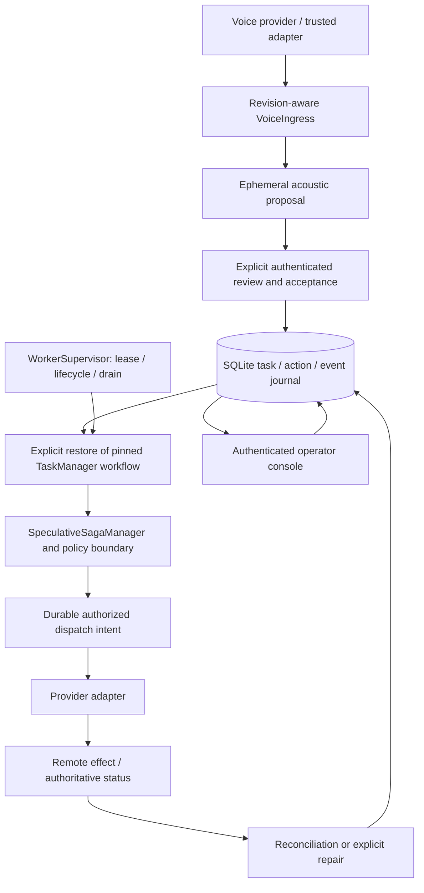

# ChronoCortex-Saga implementation record

Review date: **2026-10-31** (client date). Repository:
[dushyant-puro/chronocortex-saga](https://github.com/dushyant-puro/chronocortex-saga).

This is an implementation and acceptance ledger, not a production-readiness
certificate. The thesis remains **VOICE TURN ≠ TASK**: conversational evidence
can change while task identity, operation claims and possible remote effects
remain durable and accountable. A UI, coroutine cancellation or local state
transition cannot establish that a remote effect was undone.

## Source and evidence status

| Label | Meaning in this report |
| --- | --- |
| **PUBLIC MAIN VERIFIED** | Public `main` was verified at `4162ec17f4bda15c13de3fa1f0e1e33e3fe35591`, the Phase 0 baseline. It does not contain the safety stack. |
| **LOCAL BRANCH VERIFIED** | The implementation was inspected/tested at the stated branch or commit. Published feature branches contain the stack, but they are unmerged. Tests apply to their exact source. |
| **REPORTED BUT UNVERIFIED** | A historical claim without inspected code or retained evidence. It cannot close an acceptance gate. |
| **SIMULATED** | Synthetic voice or fake provider effects, including real subprocess/TCP/SQLite drills. Real transport/processes do not make the provider real. |
| **REAL PROVIDER** | Actual provider account, permissions, operation and authoritative reconciliation. This acceptance has **not run**. |

The preceding feature is [draft PR #29](https://github.com/dushyant-puro/chronocortex-saga/pull/29),
branch `codex/reviewed-task-admission`, head
`0b29abf8ae39cda0df8e9ce6ff9289c59d3a59bb`. Its base is the Windows setup
diagnostics branch at `37e1d86`. The subsequent bounded qualification phase starts
from this head on `codex/qualification-failure-evidence`, [draft PR #30](https://github.com/dushyant-puro/chronocortex-saga/pull/30).
Its observer/regression implementation is `452b8b9f556cc5eee2d93a93214d493ff9ee7367`;
the report follow-up `973f532` passed all ten push/PR CI jobs. The current
hands-on feature is [draft PR #31](https://github.com/dushyant-puro/chronocortex-saga/pull/31),
branch `codex/local-acceptance-walkthrough`, implementation `93813f9`.
No merge, tag, release
or deployment has been performed as part of these phases.

Historical prototype phase numbers extend beyond the original roadmap and
include gaps/revisions. They are not counts of production-complete phases.
In particular, a previous local implementation report was not evidence that
public `main` contained it. Current branch ancestry and remote refs are the
source of truth; do not replace this stack with the Phase 0 checkout.

## What you can test now

The [local acceptance walkthrough](docs/engineering/local-acceptance.md) runs a
real authenticated console, supervised two-step task and separate approvals
against a **SIMULATED** SQLite effect ledger. On Windows, from a qualified
checkout/environment:

```powershell
.\scripts\start_local_acceptance.ps1
```

It creates a unique protected directory outside Git, prints the loopback URL,
and retains evidence on stop. Use its `operator.secret` only in the local login
form and `SIMULATED-local-worker` as the execution principal. Never paste the
credential into chat. Approve each step separately, disconnect/reconnect, or
cancel before/after the first fake effect. Existing runs cannot be resumed or
overwritten. Follow the runbook for clipboard handling and exact expectations.

This is a canned pre-admitted fixture, not the missing interactive
transcript-to-task review flow. No actual payment or microphone is involved.
The workspace `.venv` was prepared offline and passed the runtime audit during
this phase; other checkouts still need the locked environment setup.

## Architecture and authority flow



The review-to-task path is currently a **trusted local host API**, not a
connected browser workflow. Voice proposals alone cannot authorize admission,
approve a mutation, cancel work or complete a task. The web UI observes durable
facts and submits scoped commands; it is never the source of truth.

The architecture remains modular and local: one durable SQLite journal with
worker ownership and explicit process/provider boundaries, rather than a set
of speculative microservices. SQLite/host fencing does not fence an already
authorized request at an external provider.

## Implemented milestones

These are verified code milestones, with the remaining acceptance boundaries
stated explicitly. Commit anchors identify the implementation history; later
hardening supersedes assumptions in earlier prototypes.

| Milestone | Implementation / anchor | Acceptance limit |
| --- | --- | --- |
| Original race hardening | `bc22c80`; later `0413fa3`, `c643306`. Conservative stale/UNKNOWN outcomes and task advancement checks. | Phase 0's documented ABORTED-to-COMMITTED race must not be confused with external rollback. The baseline was not re-run for this report. |
| Execution/repair ownership | `1b5dfa5`, `a2b7e12`. Serialize reconciliation/compensation; task/step/generation ownership and chain isolation. | Provider uncertainty still requires authoritative evidence. |
| Durable dispatch intent | `b48b897`; [journal contract](docs/engineering/durable-action-intent.md). Persist intent, claims and events before external execution. | Storage failure stops progress; local evidence is not provider truth. |
| Worker lease fencing | `25e7790`; [lease runbook](docs/engineering/worker-lease-fencing.md). Explicit expiring ownership and takeover fencing. | A local lease cannot undo or fence a remote effect by itself. |
| Workflow compatibility | `c879cf7`; [workflow contract](docs/engineering/workflow-contract-versioning.md). Pin workflow/step/provider/handler revisions; reject drift on restore. | Declared versions are deployment assertions, not inferred code equivalence. |
| Durable local security | `5203635`, `00e6237`; [security authority](docs/engineering/durable-security-authority.md). Provisioned bearer credentials, principal versions, revocation/expiry and operation-bound approvals consumed with intent. | Trusted local provisioning is not remote login, OIDC or hostile-process isolation. |
| Operator console | `c0935a1`; [console](docs/engineering/operator-control-console.md). Authenticated sessions, CSRF, exact evidence review, durable approval/cancel/investigation commands. | No model/speech authority; UI does not own state. |
| Supervision and drain | `9377235` through `9cfe59d`; [worker supervision](docs/engineering/worker-supervision.md). Own startup/renewal I/O, fence failures, shield consumer cancellation, preserve unresolved work across shutdown. | Service packaging/watchdogs/SLOs and intermittent contention findings remain open. |
| Provider reconciliation | `4e28a97`, `5fa0211`, `b894a86`; [provider boundary](docs/engineering/provider-reconciliation.md). Restricted Stripe test cancellation, receipts, GET-only inspection/reconciliation. | **REAL PROVIDER acceptance not run**; adapter tests and fake remote ledgers are **SIMULATED**. |
| Sandbox onboarding | `4bf04f9` through `3d34530`; [setup guide](docs/engineering/stripe-sandbox-setup.md), [supervised drill](docs/engineering/supervised-stripe-drill.md). Protected Windows key setup, GET-only preflight, explicit one-shot supervised cancellation procedure. | No account/key is assumed available. No blind mutation retry. |
| Voice evidence boundary | `c947048` through `d1c335b`; [voice evidence](docs/engineering/voice-evidence.md). Revision replacement, stale callbacks, strict confidence/timing, proposal-only LiveKit hook, synthetic replay. | Actual microphone/WebRTC/STT/playback/identity/consent acceptance remains open. Historical SDK integration is not current live acceptance. |
| Independent process faults | `5475fea`, `f252874`; [process drills](docs/engineering/provider-process-faults.md). Separate worker/proxy/service processes, real loopback TCP, independent durable effect ledger, GET-only recovery. | Five selected **SIMULATED** schedules; not provider idempotency fidelity or production latency. |
| Reproducible dependencies/security | `39e79f6` through `1984b87`; [locks](docs/engineering/locked-environments.md), [advisories](docs/engineering/dependency-advisories.md). Hash-locked graphs, exact environment checks, isolated advisory coverage and CI evidence. | An advisory scan does not certify all security properties or future vulnerability absence. |
| Recovery evidence and custody tools | `25ce918` through `43aa37d`; [preflight](docs/engineering/recovery-preflight.md), [backup drills](docs/engineering/journal-backup-drills.md), [encryption](docs/engineering/encrypted-backups.md), [rotation](docs/engineering/backup-key-rotation.md). Bounded read-only inspection, no-clobber snapshots, memory restore drills, authenticated encryption and non-destructive key rotation. | Freshness, independent off-host custody, current provider reconciliation and live activation are separate gates. |
| Comparative research scaffolding | `722b3f4`, `3f09fd1`; [comparison](docs/engineering/mutation-comparison.md). Independent effect oracles, explicit toy controls and production-path ablation. | Small selected synthetic corpus; no universal novelty or deployment-rate claim. |
| Durable multi-step evaluation | `eb09d82` through `79b91a2`; [task evaluation](docs/engineering/durable-task-evaluation.md), PR #24. Real task/saga/supervisor code, three-step workflows, voice/task isolation, separate completed/parked/cancelled outcomes. | Broader held-out cases, fair comparators and real measurements remain open. |
| Offline wheel qualification | `3908b7a` through `1d303b3`; [offline wheels](docs/engineering/offline-wheels.md), PR #25. Complete per-package, host-compatible, digest-verified archives; documented exact broad-tag exception. | Bootstrap/native assets, archive custody and real deployment recovery still need qualification. |
| Console recovery | `b3d44f0` through `c0fc03f`; [read recovery](docs/engineering/console-read-recovery.md), PR #26. Recover transient reads; fence old-session responses/cleanup; retain uncertain command warnings. | Does not justify retrying an unknown command or close native reliability findings. |
| Safe diagnostics | `f20075a` through `04197c0`; [diagnostics](docs/engineering/failure-diagnostics.md), PR #27. Bounded failure categories and peer context without raw exception payloads. | Failure categories alone do not identify lock holders or causal schedules. |
| Windows setup qualification | `6b60f99`, `37e1d86`; [setup diagnostics](docs/engineering/windows-setup-qualification.md), PR #28. Opt-in secret-free stages, unchanged 20-second test budget, retained JUnit on CI failure. | Historical timeout cause is unconfirmed; no security assertion/timeout was weakened. |
| Authenticated task admission | `587342a`, `0b29abf`; [admission contract](docs/engineering/reviewed-task-admission.md), PR #29. Current evidence + reviewer/version/credential + exact static arguments + pinned workflow -> atomic PENDING task/audit. Duplicate acceptance preserves progress. Separate operation approvals remain required. Schema 7 fences old workers. | Local host API only. Protected browser review, durable proposal inbox, dependent plans and participant identity remain open. |
| Pre-cleanup qualification evidence | `452b8b9`; [failure evidence](docs/engineering/qualification-failure-evidence.md), PR #30. Bounded all-peer observations, read-only ledger counters, no-clobber redacted CI artifacts, typed failed-scorecard evidence and deterministic post-effect contention recovery regression. | Historical root causes remain unconfirmed; observations are non-atomic and grant no retry/dispatch authority. |
| Hands-on local acceptance | `93813f9`; [walkthrough](docs/engineering/local-acceptance.md), PR #31. Unique protected Windows run, loopback-only UI, canned immutable task, real local approvals/supervisor, separate fake effect ledger, disconnect/cancel/UNKNOWN and verified shutdown behavior. | SIMULATED effects only; no human voice-proposal review UI, live provider, resume of existing runs or production hosting. |

Early prototype TaskGraph, memory/grounding and autonomy code is present in
history. Its presence does not qualify unattended production autonomy. The
current admitted-plan boundary deliberately supports static reviewed arguments;
it does not silently adopt a prototype's dynamic argument builder.

## Safety invariants protected by the current stack

1. Advancing a voice epoch cannot convert uncertain external execution into a
   proven abort, erase task identity or justify advancing a descendant.
2. An executor return is not sufficient evidence that a durable local commit
   was recorded; journal failures fence further dispatch.
3. UNKNOWN/stale/repair-in-flight outcomes retain their original operation
   identity. Recovery must reconcile, not blindly retry a mutation.
4. Dispatch/repair authority, approval consumption and durable intent commit
   together before a request is sent. Spoken confirmation is not approval.
5. Task/step/generation and chain ownership prevent cross-task compensation
   and overlapping unresolved successors.
6. Lease loss, authority loss, monotonic deadlines or persistence failure cannot
   silently reopen admission in a cached runtime.
7. Consumer/voice disconnection and cancellation of a waiting coroutine do not
   cancel owned effects or establish remote rollback.
8. Reviewed admission binds the current proposal and exact principal/credential
   version. Stale, weak, unavailable or forged acoustic evidence grants no authority.
9. An admitted static plan remains immutable across later voice corrections.
   Replacing it requires explicit task controls and uncertainty-aware review.
10. Backups, read-only inspection and passing fake-provider drills do not confer
    restore/dispatch authority or prove freshness/provider reconciliation.

## Verified test evidence by source

| Exact source | Evidence | Meaning / limits |
| --- | --- | --- |
| `79b91a2` | 1,201 Windows runtime tests passed, two skipped; all ten push/PR jobs passed. | PR #24 evidence only, not transferred to later source. |
| `37e1d86` | Fresh offline Windows environment: 1,315 passed/two skipped; Linux 1,291 passed/26 skipped; Chromium 19 on each OS; ten CI jobs passed. | PR #28 evidence. Historical Windows failure causes remained open. |
| `587342a` | Fresh GitHub clone, 80 hash-locked binary packages installed offline; Windows 1,376 passed/two skipped; process drill 5/5 and 122 checks. | Initial PR #29 implementation. CI 9/10; Windows shutdown/finalization contention failed. |
| `0b29abf` | Clean GitHub source, exact offline environment; Windows 1,377 passed/two skipped, including 62 admission cases; independent process drill 5/5 and 122 checks. | Final PR #29 source. Push CI 5/5, PR CI 4/5; Linux proxy-barrier timeout remained. |
| `452b8b9` implementation | Fresh GitHub clone/new 80-package offline environment: exact audit passed; full Windows suite 1,387 passed/two skipped. Focused suite: 91 passed, including ten added capture/contention cases. Linux CI: 1,363 passed/26 skipped. | PR #30. Qualified counts reflect the run started after installation completed and its environment audit passed. Exact final CI conclusions are recorded in the PR. |
| `973f532` report follow-up | All ten push/PR CI jobs passed; 30 artifact metadata records matched this exact head. | Documentation-only follow-up to `452b8b9`. Historical contention/barrier causes remain open. |
| `93813f9` local walkthrough | Independent fresh GitHub clone/new 80-package offline environment: Windows 1,401 passed/two skipped. Fourteen focused runtime/native cases passed. Clean-source Chromium suite: 21 passed in a separately audited browser environment, including two new desktop/mobile journeys. | PR #31 records exact-head CI. One implementation-source Windows push job failed before checkout while downloading actions; no repository tests ran in that job. This is not evidence of a code-test failure or a fully green CI result. |

Windows skips in the latest full run were the POSIX directory-mode case and
live SDK session initialization without an OpenAI API key. Neither is live
audio/provider acceptance. Generated local evidence is ignored by Git; CI
artifacts and exact job links in each PR are the published qualification record.
No performance numbers or production completion percentage are inferred.

The separate clean-source process drill at `452b8b9` passed **5/5 cases and 122
checks**. Its updated harness SHA-256 is
`c80247eae0d85ea2dfe8b30226c327be9e92f4b24d8fa9737c5edcbb2d43c34e`;
it includes the new observer module. Earlier harness hashes remain evidence
only for their earlier source. No actual provider or live audio was used.

## Unresolved reliability findings and diagnostic boundary

- [Initial Windows PR job](https://github.com/dushyant-puro/chronocortex-saga/actions/runs/41182510247/job/124482628422):
  `test_cancelled_shutdown_waiter_cannot_cancel_drain` failed with SQLite busy
  during `FORWARD_COMMITTED`; renewal `AUTHORIZE` also classified `SQLITE_BUSY`.
  Its push job, local full run and one focused follow-up passed. The actual lock
  holder/causal schedule is unconfirmed.
- [Final Linux PR job](https://github.com/dushyant-puro/chronocortex-saga/actions/runs/41188791554/job/124501093266):
  hidden-effect process drill timed out waiting for the proxy's
  `RESPONSE_WITHHELD_AFTER_APPLY` barrier. The same-commit push runtime passed.
  This does not establish whether the worker sent a request or why the barrier
  was absent. Later evaluation steps in the failed job did not run.

The reliability follow-up adds bounded observations of all peers and fixed ledger counters
**before cleanup** and retains only redacted JSON failure artifacts in CI. It
also adds a deterministic post-effect/local-finalization-contention regression:
dispatch intent survives, restart projects UNKNOWN, and the original operation
cannot be replayed. These are controlled safety schedules, not a claimed
reproduction or fix of either historical CI cause. Qualification remains
attributed to each exact source in the table and its PR; a later passing run
does not establish the earlier causal schedule.

The snapshots are separate, non-atomic observations. Missing/locked evidence is
UNAVAILABLE, not zero effects. Raw journals, credentials, provider payloads,
request paths/IDs and peer stderr must never be uploaded as diagnostic artifacts.

## Remaining stages and acceptance gates

All **seven major workstreams** remain open; each can need several bounded PRs.

| Workstream | Exit criteria |
| --- | --- |
| Real provider | Dedicated sandbox/restricted credential; GET-only setup; one exact approved disposable mutation/readback; real uncertainty/reconciliation evidence without replay. |
| Real voice | Chosen STT deployment; actual microphone/WebRTC/revision metadata/playback interruption/disconnect tests; participant identity and consent/retention. |
| Proposal-to-task product flow | Protected transcript/argument review API/UI; durable inbox/delivery; explicit correction/replacement semantics; end-to-end stale/cross-principal tests. |
| Deployment and operations | Reviewed service/container wrapper and watchdog; secrets/configuration/TLS/remote identity if exposed; retention, capacity/backpressure and measured SLOs; diagnosed reliability findings. |
| Recovery activation and custody | Retained independent off-host archives/keys/native/bootstrap assets; freshness and worker fencing; authoritative provider reconciliation before activation. |
| Independent research | Held-out licensed cases, fair comparators and ablations, refreshed related-work citations, declared denominators and real measurements. No universal novelty claim. |
| Integration and release | Review/consolidate the unmerged stack; migration/rollback/security checks on a release candidate; explicitly approved merge/tag/deployment. |

The project has substantial safety/recovery foundations and is **not a
production release candidate**. The next corrective change should follow a
deterministic causal reproduction of the observed reliability failures.

## Reproduce on Windows

Use the repository's [locked environment instructions](docs/engineering/locked-environments.md)
and [offline wheel instructions](docs/engineering/offline-wheels.md). From an
already qualified checkout/environment:

```powershell
git status --short --branch
git log -5 --oneline
git branch -avv
git ls-remote origin refs/heads/main
.\.venv\Scripts\python.exe -m scripts.dependency_audit --profile runtime --output results/environment-runtime.json
.\.venv\Scripts\python.exe -m pytest -q --junitxml=results/runtime-tests.xml
.\.venv\Scripts\python.exe -m eval.provider_faults --output results/provider-process-scorecard.json
```

The runtime suite does not require live keys. Never paste credentials into chat
or use live provider calls as a substitute for offline regression tests.

## Migration, rollback and preservation

The current runtime requires **journal schema 7**. Stop admission/dispatch,
confirm the prior process is stopped, preserve evidence and use the explicit
[offline migration procedure](docs/engineering/reviewed-task-admission.md#schema-7-migration-and-rollback).
An expired lease alone does not prove the old process stopped.

On regression, retain schema-7 journals, operation claims, approvals, generations,
receipts and remote operation IDs. Use a compatible reader/forward fix. Do not
lower the schema header, overwrite current data with an old snapshot, clear
UNKNOWN or retry mutations to make a demonstration pass. The new qualification
capture changes no schema, provider transport or worker retry/lease policy.
